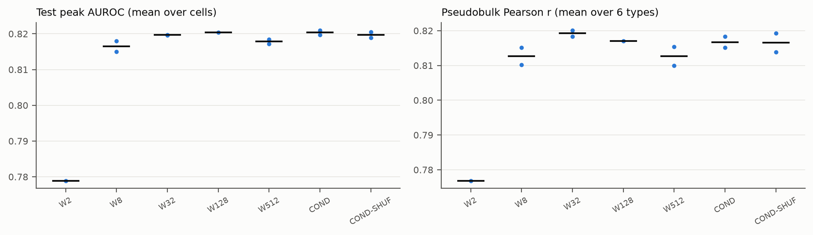
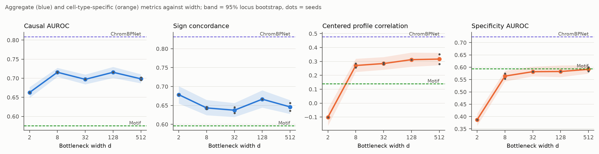
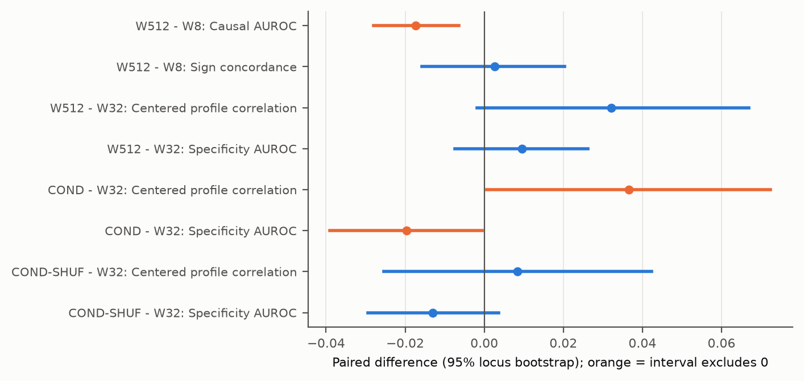
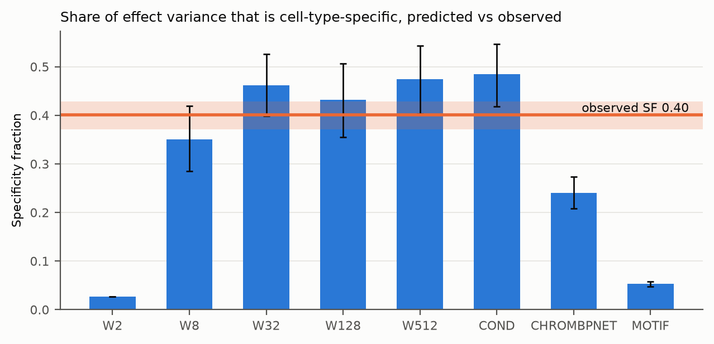
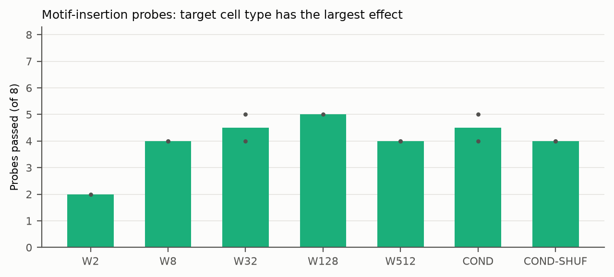

# Bottleneck width and cell-type-specific variant effects in scBasset

Report on the experiments pre-registered in [`PROJECT_PLAN.md`](../PROJECT_PLAN.md). Every
change to the plan is in [`DECISIONS.md`](DECISIONS.md) with its date, and every run is in
[`COMPUTE_LOG.md`](COMPUTE_LOG.md). All numbers below come from the committed files in
[`results/`](../results/) and regenerate with `make report`.

## 1. Conclusion

Within PBMC, trained on one donor, the 32-dimensional bottleneck of scBasset does not measurably
limit cell-type-specific variant effects. Widening it to 512 does not improve either specific
metric by a margin whose interval excludes zero (H2 not supported). Aggregate caQTL metrics are
nearly flat between widths 8 and 512, though causal AUROC falls slightly with width, and that
interval is not inside the pre-registered 0.02 margin (H1 not supported as stated). The
pre-registered conditioned head (COND) neither helps nor hurts consistently: it raises one specific
metric and lowers the other (H3 not supported). This was expected, because COND has exactly
W32's function class (section 6.2).

Width 2 is the only setting that fails, and it fails in the way the plan's argument predicts. With
rank at most 2, the predicted effect profile is close to constant across cell types: specificity
fraction is 0.03 against 0.40 observed, and centered profile correlation is -0.10.

The specific component is limited by something other than width. Every scBasset arm with d >= 8
scores specificity AUROC 0.56 to 0.59 and CPC 0.27 to 0.32. ChromBPNet models trained per cell
type on 922 TenK10K donors score 0.72 and 0.48. Predicted specificity fraction (0.43 to 0.49 for
d >= 32) is at or above the observed 0.40. The models do not compress cell-type differences in
magnitude; they place the differences on the wrong variants and cell types more often than
ChromBPNet does.

## 2. Gate G0

| Check | Value | Threshold | Result |
|---|---|---|---|
| Test peak AUROC, ctb W32 seed 0 | 0.8196 | | |
| Test peak AUROC, `scvi.external.SCBASSET` (d = 32) seed 0, same split | 0.8189 | | |
| Difference | +0.0007 | within 0.02 | pass |
| Causal test pairs in the specificity set | 1,089 | >= 300 | pass |

Source: `results/phase0/g0.json`. The scvi reference needed one change to run on MPS: its
internal AUROC metric was computed on CPU, because PyTorch's MPS `F.pad` corrupts outputs of
65,536 or more elements, which torchmetrics' binary AUROC uses. The training math was unchanged.
Reported upstream as scverse/scvi-tools#4071.

## 3. Data

- **Training data.** 10x PBMC granulocyte-sorted 10k multiome (Cell Ranger ARC 2.0.0): 11,898
  cells, 98,507 peaks accessible in >= 1% of cells. 79,443 training peaks, 4,859 validation
  peaks (chr7) and 14,205 test peaks (chr2, chr8, chr13).
- **Cell labels.** Leiden clusters on RNA labelled by marker scores, with a CD3E lineage gate,
  decoy marker sets and doublet filtering (DECISIONS, 2026-10-22): B 923, CD4 T 3,187,
  CD8 T 2,600, NK 492, CD14 Mono 3,172, CD16 Mono 494, other 1,030.
- **Ground truth.** TenK10K phase 1 caQTLs (922 donors), Hugging Face commit `a9baa08`.
  - 1,664 causal variant-peak pairs on the test chromosomes (SuSiE PIP >= 0.5 in >= 1 of the six
    types, SNV, within 600 bp of the peak center), in 726 loci.
  - 8,282 matched controls; 1,652 causal pairs have all 5.
  - 1,089 pairs whose peak is called in >= 3 types form the specificity set: 544 rows enter CPC,
    and there are 2,633 specific-positive and 1,461 specific-negative (variant, type) labels.
  - No variant failed the hg38 reference check.
- **Secondary set.** 8,177 causal pairs on the training chromosomes (3,349 loci), used for sign
  concordance only.

## 4. Results

Arm values are means over seeds. Intervals are 95% locus-bootstrap intervals (2,000 resamples of
loci, controls following their causal pair). Seeds: two for W8, W32, W512, COND and COND-SHUF,
one for W2 and W128 (section 7).

### 4.1 Model quality

| Arm | Seeds | Test peak AUROC | Pseudobulk r (mean of 6) | Best epoch |
|---|---|---|---|---|
| W2 | 1 | 0.779 | 0.777 | 23 |
| W8 | 2 | 0.817 | 0.813 | 39, 27 |
| W32 | 2 | 0.820 | 0.819 | 52, 50 |
| W128 | 1 | 0.820 | 0.817 | 39 |
| W512 | 2 | 0.818 | 0.813 | 63, 50 |
| COND | 2 | 0.820 | 0.817 | 52, 34 |
| COND-SHUF | 2 | 0.820 | 0.817 | 39, 41 |

Held-out accessibility prediction is flat from d = 8 upward (0.817 to 0.820). W512 is
0.0018 below W32 on paired seeds.

### 4.2 Variant effects against width

| Arm | Causal AUROC | Sign concordance | CPC | Specificity AUROC | SF predicted |
|---|---|---|---|---|---|
| W2 | 0.663 [0.649, 0.677] | 0.678 [0.655, 0.701] | -0.101 [-0.163, -0.037] | 0.387 [0.363, 0.412] | 0.027 |
| W8 | 0.716 [0.704, 0.727] | 0.643 [0.624, 0.665] | 0.271 [0.224, 0.319] | 0.564 [0.543, 0.586] | 0.351 [0.286, 0.419] |
| W32 | 0.697 [0.684, 0.710] | 0.637 [0.619, 0.656] | 0.285 [0.240, 0.332] | 0.582 [0.563, 0.602] | 0.462 [0.399, 0.525] |
| W128 | 0.716 [0.701, 0.730] | 0.666 [0.644, 0.690] | 0.313 [0.262, 0.364] | 0.583 [0.560, 0.608] | 0.432 [0.355, 0.506] |
| W512 | 0.698 [0.687, 0.710] | 0.646 [0.627, 0.664] | 0.317 [0.273, 0.362] | 0.592 [0.574, 0.609] | 0.474 [0.403, 0.544] |
| COND | 0.703 [0.692, 0.715] | 0.611 [0.593, 0.630] | 0.321 [0.277, 0.365] | 0.562 [0.542, 0.582] | 0.485 [0.419, 0.546] |
| COND-SHUF | 0.717 [0.705, 0.729] | 0.650 [0.629, 0.671] | 0.293 [0.249, 0.339] | 0.569 [0.550, 0.588] | 0.409 [0.342, 0.483] |
| ChromBPNet (reference) | 0.809 [0.797, 0.821] | 0.832 [0.814, 0.850] | 0.478 [0.437, 0.519] | 0.724 [0.706, 0.743] | 0.240 [0.208, 0.273] |
| Motif baseline | 0.575 [0.560, 0.592] | 0.596 [0.573, 0.619] | 0.139 [0.086, 0.188] | 0.594 [0.571, 0.616] | 0.053 [0.048, 0.058] |

Observed specificity fraction on the same variants: 0.401 [0.371, 0.428].

### 4.3 Hypothesis tests

| Hypothesis | Comparison | Metric | Difference [95% CI] | Per seed | Verdict |
|---|---|---|---|---|---|
| H1 | W512 - W8 | Causal AUROC | -0.017 [-0.028, -0.006] | -0.014, -0.020 | not supported: interval leaves (-0.02, 0.02) |
| H1 | W512 - W8 | Sign concordance | +0.003 [-0.016, +0.020] | -0.005, +0.010 | upper end at 0.0203 |
| H2 | W512 - W32 | CPC | +0.032 [-0.002, +0.067] | -0.008, +0.073 | not supported |
| H2 | W512 - W32 | Specificity AUROC | +0.010 [-0.007, +0.026] | +0.017, +0.002 | not supported |
| H3 | COND - W32 | CPC | +0.037 [+0.001, +0.072] | +0.040, +0.033 | above zero |
| H3 | COND - W32 | Specificity AUROC | -0.020 [-0.039, -0.0005] | -0.010, -0.030 | below zero |
| H3 | COND - W32 | Test peak AUROC | +0.0007 | +0.0014, -0.0001 | drop <= 0.01: met |
| H3 control | COND-SHUF - W32 | CPC | +0.008 [-0.025, +0.042] | -0.008, +0.025 | |
| H3 control | COND-SHUF - W32 | Specificity AUROC | -0.013 [-0.029, +0.004] | -0.013, -0.014 | |

- **H1, not supported as stated.** Both point estimates are within 0.02, but the causal-AUROC
  interval reaches -0.028. Its direction is the opposite of the concern that motivated the plan:
  the wider model ranks causal variants slightly worse. Sign concordance is flat, with its interval
  ending at the margin.
- **H2, not supported.** Neither specific metric improves from 32 to 512 by a margin whose
  interval excludes zero, and the two seeds disagree on the CPC change (-0.008 and +0.073). From
  8 to 512, which is not the pre-registered comparison, both metrics rise: CPC +0.046
  [+0.007, +0.084] and specificity AUROC +0.027 [+0.010, +0.045]. On these data, width matters
  below 32 and is not detectable above it.
- **H3, not supported.** COND raises CPC and lowers specificity AUROC, each with an interval that
  only just excludes zero, and the per-seed signs agree. COND versus COND-SHUF does not separate
  on either specific metric: CPC +0.028 [-0.005, +0.060], specificity AUROC -0.007
  [-0.024, +0.011].

### 4.4 Specificity fraction

At d >= 32 the predicted specificity fraction is 0.43 to 0.49, at or above the observed 0.40.
W8 is slightly below (0.35) and W2 collapses to 0.03. On these variants the models do not shrink
the cell-type-specific share of predicted effects. ChromBPNet predicts a smaller specific share
(0.24) and still places it better, with the highest CPC and specificity AUROC of any model.

### 4.5 Representation rank (descriptive)

| Arm | ISM effect matrix (2,016,000 x 6) | Predicted pseudobulk (6 x 14,205) |
|---|---|---|
| W2 | 1.00 | 1.47 |
| W8 | 2.00 | 1.83 |
| W32 | 3.31 | 2.27 |
| W128 | 3.47 | 2.31 |
| W512 | 3.48 | 2.33 |
| COND | 3.15 | 2.18 |
| COND-SHUF | 2.95 | 2.13 |

The observed pseudobulk matrix on the same peaks has entropy effective rank 3.34. Predicted
pseudobulk rank plateaus at about 2.3 from d = 32 onward, so the extra width does not translate
into more distinct cell-type accessibility programmes on held-out peaks. The ISM rank rises
with width to 32 and then flattens.

### 4.6 Motif-insertion probes

| Probe | Target | Pass rate over 12 trained runs | Most common top type |
|---|---|---|---|
| CEBPB | monocytes | 0.92 | CD14 Mono |
| SPI1 | monocytes | 0.92 | CD16 Mono |
| TCF7 | T | 1.00 | CD4 T |
| LEF1 | T | 1.00 | CD4 T |
| EBF1 | B | 0.25 | CD14 Mono |
| PAX5 | B | 0.00 | CD14 Mono |
| TBX21 | NK | 0.00 | CD8 T |
| EOMES | NK | 0.00 | CD8 T |

Runs with d >= 8 pass 4 to 5 of 8 probes and W2 passes 2. The table counts all runs with probes,
including W2. TBX21 and EOMES always rank CD8 T first. The CD8 T label here includes effector
and memory clusters, where those factors are expressed, so these two failures may reflect the
labels rather than the model (inferred, not tested). The B-cell probes fail at every width.

## 5. Exploratory analysis (added after results were seen)

W2's pooled specificity AUROC of 0.39 is below chance. W2 places its largest |E| in CD4 T for
every variant (verified), so its centered |E| ranks the six types in one fixed order for every
variant. The pooled AUROC then scores that order against the types' different positive-label
rates (0.27 for CD8 T to 0.88 for CD14 Mono). A within-type version, AUROC per cell type averaged
over types, removes per-type offsets (`results/exploratory_within_type_specificity_auroc.tsv`):

| | Within-type specificity AUROC |
|---|---|
| W2 | 0.573 [0.546, 0.599] |
| W8 | 0.581 [0.558, 0.602] |
| W32 | 0.596 [0.576, 0.617] |
| W128 | 0.603 [0.580, 0.628] |
| W512 | 0.609 [0.591, 0.628] |
| COND | 0.578 [0.557, 0.599] |
| ChromBPNet | 0.726 [0.705, 0.745] |
| W512 - W32 | +0.013 [-0.005, +0.031] |
| W512 - W8 | +0.028 [+0.011, +0.047] |
| COND - W32 | -0.018 [-0.039, +0.002] |

The conclusions for H2 and H3 are the same under this version. The pooled metric remains the
pre-registered one.

## 6. Interpretation

### 6.1 What limits the specific component

Three observations point away from bottleneck width:

- Specific metrics are flat above d = 32.
- Predicted specificity fraction matches the observed one.
- The per-cell-type ChromBPNet models, which have no shared bottleneck, are far ahead on every
  metric.

ChromBPNet differs from these models in several ways at once: 922 donors against one, per-type
pseudobulk profiles against binarized single cells, a 2,114 bp input, and training folds that
include this project's test chromosomes. Which of these accounts for the gap is not tested here.

The plateau of predicted pseudobulk rank at about 2.3 against an observed 3.34 is consistent with
the training signal limiting how many distinct cell-type programmes the model learns, rather than
the representation's capacity (inferred).

### 6.2 Why COND could not test H3

`w_c . (z * (1 + gamma_t) + beta_t) + b_c = (w_c * (1 + gamma_t)) . z + (b_c + w_c . beta_t)`.
Each cell's readout `w_c` is free, so the FiLM scale is absorbed into it, and the shift becomes
a per-cell constant that cancels in an alt-minus-ref effect. COND therefore has W32's function
class, and any difference between them comes from optimization. The observed result fits that:
small effects of opposite sign on the two specific metrics, and no separation from the shuffled
control.

A head that conditions before the bottleneck, so that z itself depends on the cell type
(COND-PRE, added 2026-10-22), was implemented and parameter-matched but not trained, under the
time budget (section 7).

### 6.3 Rank arithmetic

With six cell types, any width d >= 6 removes the algebraic limit on effect profiles, because
the six mean cell vectors can span the six types independently. W2 is the only arm whose
profiles are rank-limited, and it is the only arm that collapses. The plan's question, whether 32
dimensions leave room, is answered yes for six PBMC types. Atlases with hundreds of cell types,
where d is below the number of types, are where this question can have a different answer.

## 7. Deviations from the plan

Each is recorded in `DECISIONS.md` at the time it was made.

- **Seeds.** Two seeds for W8, W32, W512, COND and COND-SHUF, one for W2 and W128, instead of
  three per arm, under a time budget set mid-run. Every pre-registered comparison is paired on
  two seeds.
- **Added arm not trained.** COND-PRE and COND-PRE-SHUF were added before any result and then not
  trained.
- **Secondary analysis.** Limited to sign concordance on the training chromosomes, because
  nominal TenK10K slopes were streamed for the test chromosomes only.
- **Parameter matching.** COND is matched to within one pre-bottleneck channel: 290 parameters
  fewer than W32's 4,898,850.
- **ChromBPNet reference.** Scored locally from the released weights, through a PyTorch port
  validated against TenK10K's own scores (r = 0.998 for CD14_Mono, 0.93 for B_naive), because the
  released scores do not cover controls.
- **10x fragments.** Not downloaded. The peak x cell matrix comes from the Cell Ranger ARC
  filtered matrix.
- **Exploratory metric.** The within-type specificity AUROC (section 5) was added after results.

## 8. Claims withdrawn or corrected during the work

1. **First-pass cell labels.** Argmax over marker scores labelled a CD3E+ cytotoxic CD8 T
   cluster and a MAIT cluster as NK, and kept B-monocyte and T-monocyte doublet clusters. This
   was corrected with a lineage gate, decoys and doublet filtering before any model was trained.
2. **The plan's claim that COND tests whether conditioning widens the bottleneck.** Withdrawn
   before any result: COND is a reparameterization of W32 (section 6.2).
3. **COND-PRE as the test of the question H3 was meant to ask.** Announced in DECISIONS on
   2026-10-22 and not delivered, because it was cut under the time budget. That question remains
   open.
4. **W2's below-chance specificity AUROC as variant-level anti-specificity.** Not supported. It
   is a fixed per-type ranking scored against unequal base rates (section 5).

## 9. Limitations

- **One training donor and six PBMC types.** Nothing here transfers to larger cell-type
  catalogues, where the rank argument in 6.3 bites.
- **Two seeds for the hypothesis arms, one for W2 and W128.** The locus bootstrap captures
  variant sampling, not seed variance. The two seeds disagree on the sign of W512 - W32 CPC.
- **Label mismatch.** Training labels mix naive and memory or effector cells, and TenK10K labels
  are naive only for B, CD4 T and CD8 T.
- **Not a held-out comparison.** ChromBPNet folds include the test chromosomes, and it was
  trained on the same TenK10K cohort that provides the caQTLs.
- **Specificity labels depend on TenK10K power.** CD14 Mono has the most nuclei and the highest
  positive rate (0.88), and a "not significant" call in a low-power type is weak evidence of no
  effect.
- **Compute.** Single runs per seed and fixed hyperparameters from scBasset. No learning-rate or
  regularization sweep was run for wider bottlenecks, so W512 may be under-tuned.

## 10. Compute

All work ran on one Apple M4 Max (MPS). About 22 hours of logged compute: 12 training runs
(39 to 100 minutes each), the scvi reference (133 minutes), ChromBPNet scoring (80 minutes),
per-run scoring (about 15 minutes each) and nominal-pair streaming (51 minutes). One COND-PRE run
was stopped after about 70 minutes, with no result. No money was spent.
